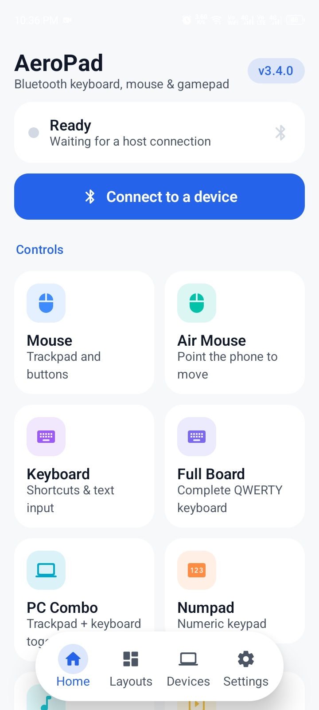
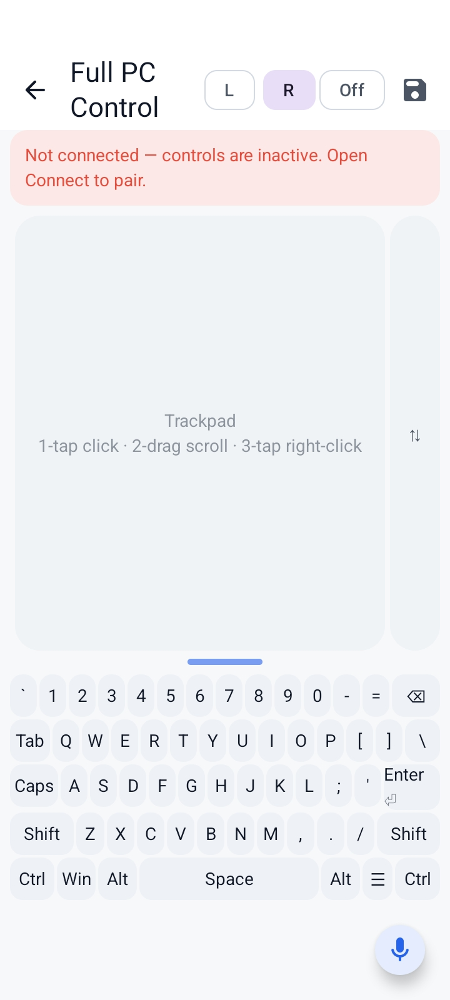
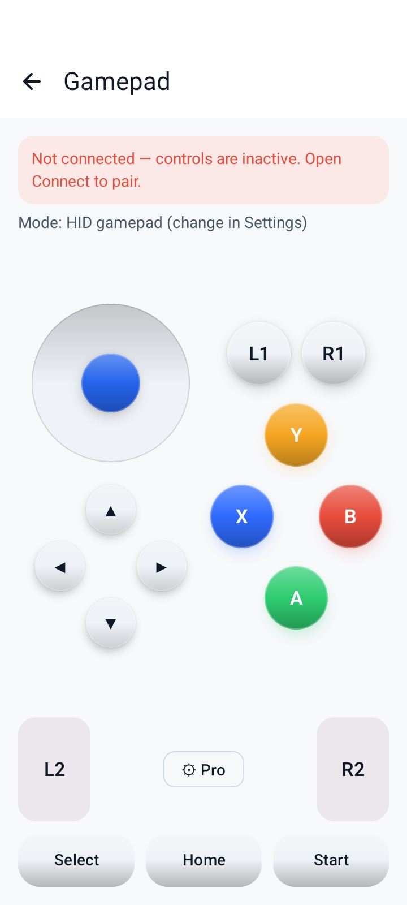
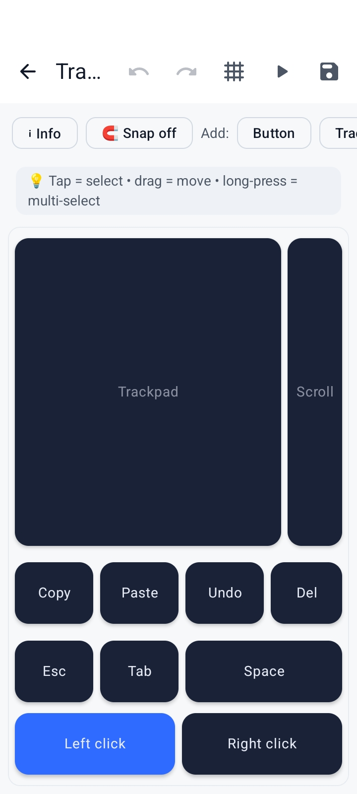
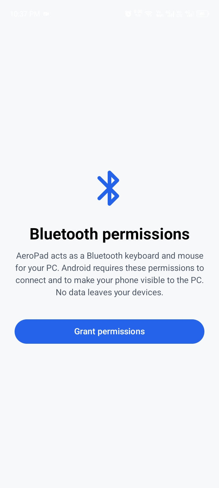

# AeroPad

**Your Android phone as a real Bluetooth keyboard, mouse & gamepad** — for any PC, laptop, Android device, tablet, TV or console that accepts Bluetooth input. No companion software, no account, no cloud, no ads: input travels straight over Android's Bluetooth HID Device API.

Built 100% in Kotlin + Jetpack Compose (MVVM + Clean Architecture, Hilt, Room, DataStore), release-signed and published to GitHub Releases by CI.

## Screenshots

| Home | Full PC Control | Gamepad | Layout editor | First-run permissions |
|:---:|:---:|:---:|:---:|:---:|
|  |  |  |  |  |

## At a glance
- **Controls:** trackpad mouse & air mouse, full QWERTY board with per-key remap/colors, shortcut keyboard, numpad, media remote, presenter, Android-TV remote, HID gamepad with stick/D-pad/triggers, absolute Touch Screen surface.
- **Pro gamepad:** gyro aim, tilt steering, analog triggers and per-game tuning profiles.
- **Make it yours:** drag-and-drop layout editor (widgets, zones, styling, undo), multi-device profiles (every host remembers its own layout), shortcut decks, macros, Quick Text & clipboard tools, Light/Dark/System themes plus Glass/Neon UI styles.
- **Reliability first:** legacy 3.3.0-compatible HID descriptor by default, GET_REPORT replies + idle keep-alive for picky hosts, anti-flap reconnect logic, live connection-health dashboard with optional spoken alerts.
- **Private:** no internet use, no analytics; input goes only to the paired host.

## Features

### Core controls
- **Mouse** — trackpad with tap-click, double-tap, long-press right-click, scroll strip, L/M/R buttons; sensitivity, smoothing, pen mode, tap-to-click, invert scroll all tunable.
- **Air Mouse** — point the phone to move the cursor (motion-driven).
- **PC Keyboard** — text-send bar, shortcuts (copy/paste/cut/select-all/save/undo/redo), F1-F12, arrows + navigation cluster, combos (Alt+Tab, Alt+F4, Win+D, Win+L, Ctrl+Shift+Esc).
- **Full Board** — complete on-screen QWERTY with per-key remapping and colors.
- **Numpad** — real keypad usage codes, calculator layout.
- **Multimedia** — play/pause, stop, tracks, volume, mute, brightness.
- **Presenter** — big prev/next, start/from-here, black/white screen, end.
- **Android Remote** — dedicated Home / Back / Recents / Power + volume & media for Android phones, tablets and Android TV (all real HID — no host app needed).
- **Gamepad** — virtual stick + D-pad + ABXY + shoulders + analog triggers; three modes: real HID gamepad, keyboard fallback, mouse+keyboard hybrid; sensitivity + dead-zone tuning; Pro mode with gyro aim / tilt steering and per-game profiles.
- **Touch Screen** — absolute-position digitizer surface (opt-in extended HID reports).

### Customization engine
- **Layouts** — build your own control screens from widgets: buttons, trackpads, scroll strips, joysticks, sliders, D-pads.
- **Edit Mode / Preview Mode** — drag to move (grid snap), corner handle to resize, undo, live preview.
- **Full styling per widget** — background/content color, opacity, corner radius, shadow, font size, label, emoji icon, visibility.
- **Action binding** — bind any key/chord, media control, mouse click, text string, or macro to any widget (tap AND long-press).
- **Zone splitter** — one tap splits the canvas into combo regions (trackpad + keys, split H/V, 2x2 grid) — any widget type in any zone.
- **Multi-device profiles** — layouts bound per host; each paired device restores its own setup.
- **Smart Shortcut Decks** — one-tap grids of your most-used actions.
- **Combo profiles** — save unlimited layouts; switch with arrows or swipe in the player.
- **Import/export** — share layouts as `.bplayout.json` files via the system file picker.
- **2 built-in templates** — Media Remote, Trackpad + Keys.

### Macros & text tools
- Step sequences: key taps, chords (Ctrl+Alt+Del), text typing, media, mouse clicks, delays.
- Build, reorder, test-play live, save — then bind to any custom button.
- Quick Text clips + local clipboard mirror for fast typing on the host.

### Settings & quality of life
- Appearance: **Light / Dark / Follow system** (clean white or pure black — nothing else), plus Glass/Neon UI styles and hidden-tile dashboard personalization.
- Fullscreen, keep screen on, touch vibrations (3 strengths), secure screen (blocks screenshots), reduce motion, FPS overlay, optional Tasker automation API.
- Quick Connect tile + notification actions; connection-health dashboard with real link metrics and optional spoken alerts.
- Mouse, keyboard and gamepad tuning applied live everywhere.

## Requirements
- **Android 10 (API 29) or newer.**
- A phone/ROM that supports **Bluetooth HID Device mode** (most do; some ROMs block it — the app detects and reports this).
- A host that accepts Bluetooth keyboards/mice: Windows, macOS, Linux, Android/Google TV, most smart TVs. iOS/iPadOS: keyboard yes; mouse depends on OS version + AssistiveTouch settings.

## Pairing with a PC (Windows)
1. Open AeroPad → **Connect** → **Prepare PC pairing** (accept discoverability).
2. Windows: Settings → Bluetooth & devices → **Add device** → Bluetooth → select the phone.
3. Accept pairing on **both** sides; wait for **Connected**.
4. Test Keyboard (Space) first, then Mouse.
5. Stuck? Remove the pairing on BOTH sides and retry with AeroPad open.

## Install
Grab the latest signed APK from [GitHub Releases](../../releases/latest).
If an older debug-signed build is installed, uninstall it once first (Android signature rules); every later update installs cleanly over the release-signed build.

## Build
```bash
./gradlew :app:assembleDebug        # debug APK
./gradlew :app:assembleRelease      # release APK (signed when secrets present)
./gradlew :app:testDebugUnitTest    # unit tests
./gradlew :app:connectedDebugAndroidTest   # Compose UI tests (device needed)
```
JDK 17, Android SDK 34. CI (GitHub Actions) runs tests + lint, builds the APK and publishes signed builds to GitHub Releases.

### Release signing
Add these repository secrets to sign releases with your own key:
`KEYSTORE_B64`, `KEYSTORE_PASS`, `KEY_ALIAS`, `KEY_PASS`.
Without them CI signs with the debug key (installable for testing) and skips publishing.

## Privacy & security
- No internet permission use, no analytics, no account.
- Backups and data extraction disabled.
- Optional secure-screen mode blocks screenshots/app-switcher previews.
- Foreground service is not exported; HID input goes only to the paired host.

## Architecture
```
ui/          Compose screens + generic WidgetRenderer (data-driven UI)
viewmodel/   MVVM state holders (StateFlow)
domain/      Interfaces + UseCases + pure logic (editor ops, macro engine, pointer math)
data/        Room (layouts/macros/skins) + DataStore (settings) + JSON serializers
hid/         HID descriptors, report builders, char map, crash-proof HidEngine
service/     Foreground HidService
```
Key invariants:
- Every Bluetooth call is exception-guarded — a disconnect can never crash the app.
- Every stored/imported value is validated (`sanitized()`) before use.
- Sealed-class states everywhere; no nullable state soup.
- Pure logic (report builders, editor ops, macro expansion, pointer math) is unit-tested.
